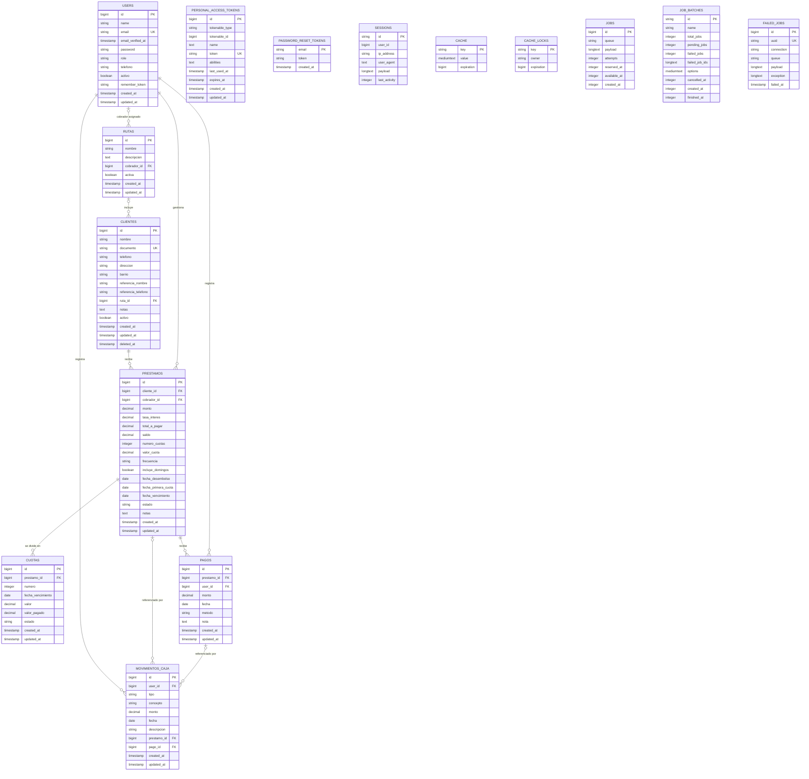

# ERD de la base de datos

Este diagrama refleja las tablas definidas por las migraciones del proyecto. Incluye las entidades del negocio y las tablas auxiliares de Laravel.

## Reglas y notas

- `RUTAS.cobrador_id` y `CLIENTES.ruta_id` son opcionales; al eliminar el cobrador o la ruta, el campo se establece en `NULL`.
- `CUOTAS.prestamo_id` se elimina en cascada cuando se elimina el préstamo. La combinación `(prestamo_id, numero)` es única.
- Las FK `PRESTAMOS.cliente_id`, `PRESTAMOS.cobrador_id`, `PAGOS.prestamo_id`, `PAGOS.user_id` y `MOVIMIENTOS_CAJA.user_id` son obligatorias y no especifican borrado en cascada.
- `MOVIMIENTOS_CAJA.prestamo_id` y `pago_id` son opcionales; se establecen en `NULL` al eliminar el préstamo o el pago correspondiente.
- `CLIENTES` usa borrado lógico (`deleted_at`). `documento` es único.
- `PERSONAL_ACCESS_TOKENS` usa una relación polimórfica (`tokenable_type`, `tokenable_id`), por lo que no tiene una FK convencional a `users`.
- `SESSIONS.user_id` está indexado, pero la migración no define una FK.
- Las tablas auxiliares de caché y colas (`CACHE`, `CACHE_LOCKS`, `JOBS`, `JOB_BATCHES`, `FAILED_JOBS`), junto con `PASSWORD_RESET_TOKENS`, no tienen relaciones FK declaradas.
- Las columnas `decimal` monetarias usan precisión `(14, 2)`; `PRESTAMOS.tasa_interes` usa `(6, 2)`. `CLIENTES.documento`, `telefono` y `referencia_telefono` tienen longitud máxima de 30 caracteres.
